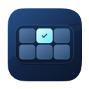

# ClipDeck для macOS



ClipDeck — менеджер буфера обмена в строке меню macOS. Он открывает панель выбора по **⌘C** и **⌘V**. В ней доступны системный буфер и до 30 номерных ячеек для сохранённых фрагментов.

## Основные функции

- **Копирование и вставка.** Нажмите **⌘C**, чтобы скопировать фрагмент и выбрать ячейку для его сохранения. Нажмите **⌘V**, чтобы выбрать источник вставки. Повторное нажатие той же комбинации выбирает ячейку по умолчанию.
- **Выбор ячеек.** Выбирайте ячейки мышью. Для первых десяти ячеек также доступны клавиши **1–9** и **0**, где **0** выбирает ячейку 10. Ячейка **«Система»** работает с текущим буфером macOS. **Esc** закрывает панель.
- **Предпросмотр.** Наведите курсор на ячейку, чтобы увидеть текст, миниатюру изображения или список путей к файлам.
- **Очистка ячейки.** Наведите курсор на заполненную номерную ячейку, переведите курсор в карточку предпросмотра и нажмите **Очистить**. Удаляется содержимое выбранной ячейки.
- **Пауза.** Откройте меню ClipDeck и выберите **Приостановить**. Пока ClipDeck на паузе, **⌘C** и **⌘V** работают как обычно. Нажмите **Включить**, чтобы снова открывать панель и пользоваться сохранёнными ячейками.
- **Хранение.** Номерные ячейки хранятся в памяти до выхода из ClipDeck.

## Установка

Требуется **macOS 13 или новее**. Для сборки установите **Swift 5.9 или новее** из Xcode или Command Line Tools. Для установки Command Line Tools выполните `xcode-select --install`.

Выполните сборку и установку из папки проекта.

```bash
bash scripts/build.sh
bash install.command
```

Установщик помещает ClipDeck в `~/Applications` и запускает приложение.

## Настройка

1. После первого запуска разрешите ClipDeck **Универсальный доступ** в разделе **Системные настройки → Конфиденциальность и безопасность**.
2. Если сочетания не работают, откройте **ClipDeck → Настройка доступа и справка…**. Если окно рекомендует **Мониторинг ввода**, разрешите его для ClipDeck.
3. В меню **ClipDeck → Настройки…** задайте от **1 до 30** номерных ячеек, выберите тему и нажмите **Применить**. По умолчанию доступны **10** ячеек. Для темы Liquid Glass нужны macOS 26 и сборка с macOS SDK 26 или новее и Swift 6.2 или новее.
4. В меню **Буфер по умолчанию** выберите ячейку для повторного нажатия **⌘C** или **⌘V**. Изначально выбрана ячейка **1**.
